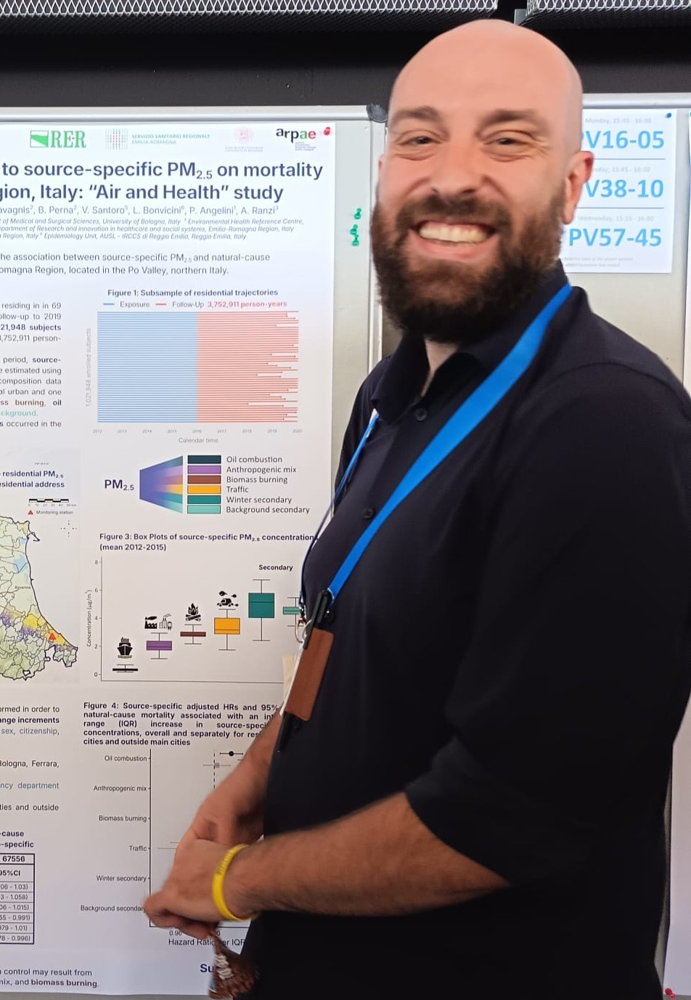

## Simone Agostini

<!--
**SimoNeedle/SimoNeedle** is a ✨ _special_ ✨ repository because its `README.md` (this file) appears on your GitHub profile.

Here are some ideas to get you started:

- 🔭 I’m currently working on ...
- 🌱 I’m currently learning ...
- 👯 I’m looking to collaborate on ...
- 🤔 I’m looking for help with ...
- 💬 Ask me about ...
- 📫 How to reach me: ...
- 😄 Pronouns: ...
- ⚡ Fun fact: ...
-->
<table>
<tr>
<td width="70%"  style="border: none;" valign="top">

  ### Who am I?

MD, currently serving as _Public Health and Preventive Medicine_ resident at the [University of Bologna](https://www.unibo.it/it/studiare/dottorati-master-specializzazioni-e-altra-formazione/scuole-di-specializzazione/scuole-di-specializzazione-mediche-nuovo-ordinamento/igiene-e-medicina-preventiva) 
Currently enrolled in the 2nd Level Master in _Geospatial Data Science for Human, Animal, and Environmental Health (GEO4H)_ at [University of Padova](https://uel.unipd.it/master-e-corsi/geo4h-geospatial-data-science-per-la-salute-delluomo-degli-animali-e-dellambiente/)
  
I'm mainly interested in:

💧  Environmental epidemiology and environmental justice  
🫂  Social epidemiology, social determinants of health and inequities  
💉  Organization of primary healthcare (PHC) services  
🦟  Epidemiology of communicable diseases  
🗺️  Geospatial analysis for public health: territories, proximity and communities  

 
I would like to professionally contribute to these fields through both scientific research and its practical translation, in the context of healthcare organization.

</td>
<td width="30%"  style="border: none;" valign="top">

</td>
</tr>
</table>
  

_Powered by blast beats, questionable dad jokes, unsolicited nerdy anecdotes, eco-anxiety, and tons of coffee to keep feeling that beat._

